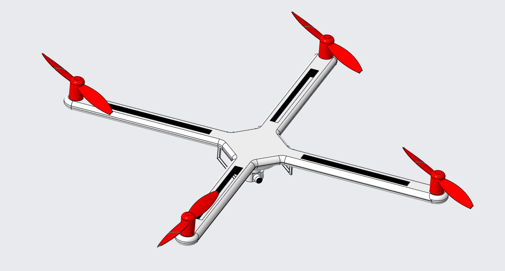
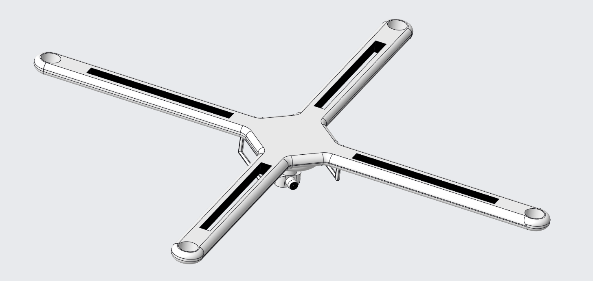
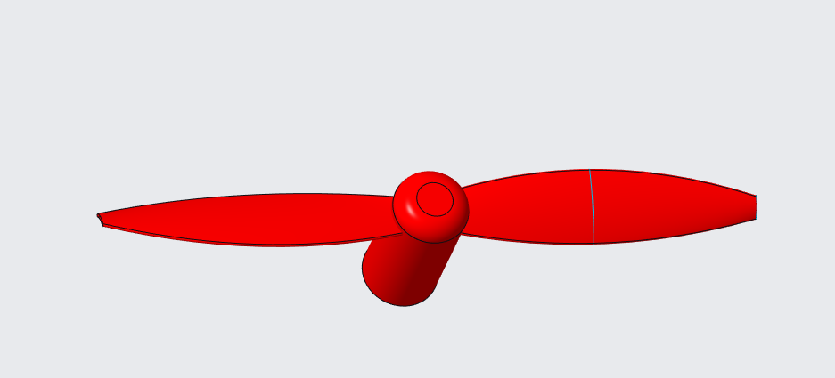

# 🚁 Drone_Creo – Quadcopter Drone 3D CAD Model (PTC Creo)

A 3D CAD design of an X-configuration quadcopter drone, modelled in **PTC Creo Parametric**. The repository contains the drone frame, the propeller blade, and the final assembly.

> 🎓 Designed by **Mohd Warish**, B.Tech Mechanical Engineering, NIT Patna

---

## 📸 Preview

### Final Assembly


### Drone Frame


### Propeller with Motor Mount


---

## ✨ Features

- **X-type quadcopter frame** with four symmetric arms joined to a central hub
- **Slotted arms** to reduce weight and allow wiring / component routing
- **Rounded arm tips** that serve as motor seating areas
- **Two-blade tapered propellers** with cylindrical motor housings
- **Camera / gimbal unit** mounted under the central body
- **Landing legs** under the frame
- Fully **assembled model** with the propellers placed on all four arms

---

## 📂 Repository Structure

| Folder | File | Description |
|--------|------|-------------|
| `Drone/` | `drone1.prt.3` | Main drone frame (central hub, arms, camera mount, legs) |
| `Blade(Propeller)/` | `drone_blade.prt.3` | Propeller blade with motor housing |
| `Assemble/` | `drone_blade_assem.asm.1` | Final assembly of frame + four propellers |
| `Images/` | `Assmeble.png`, `Frame.png`, `Propeller.png` | Screenshots used in this README |

---

## 🛠️ Tools Used

- **PTC Creo Parametric** – part modelling and assembly
- **Git & GitHub** – version control

---

## 🚀 How to Open the Project

1. Install **PTC Creo Parametric**.
2. Clone the repository:
   ```bash
   git clone https://github.com/warish121/Drone_Creo.git
   ```
3. Creo assemblies look for their parts in the working directory, so copy these three files into **one folder**:
   - `drone1.prt.3`
   - `drone_blade.prt.3`
   - `drone_blade_assem.asm.1`
4. In Creo, set that folder as the **Working Directory** (right-click the folder in the file browser → *Set Working Directory*).
5. Open `drone_blade_assem.asm` to view the full assembly. Creo loads the latest version of each file automatically.

> The `.3` / `.1` at the end of the file names are Creo version numbers. If Creo can't find a file, make sure all parts are in the working directory.

---

## 📐 Specifications

| Parameter | Value |
|-----------|-------|
| Configuration | Quadcopter (X-type) |
| Number of Propellers | 4 (2 blades each) |
| Wheelbase | 611 mm (motor-to-motor, diagonal) |
| Propeller Size | 200 mm (~8 inch) diameter |
| Intended Frame Material | _e.g. carbon fibre / ABS / aluminium_ |
| Software | PTC Creo Parametric |

---

## 🔮 Future Improvements

- Add motors, ESCs, flight controller and battery to the assembly
- Run **FEA** on the frame and **CFD** on the propeller
- Weight and centre-of-gravity optimisation
- Export **STEP / STL** files for use in other software and 3D printing
- Create engineering drawings with dimensions

---

## 👤 Author

**Mohd Warish**
B.Tech, Mechanical Engineering – NIT Patna

- GitHub: [@warish121](https://github.com/warish121)

⭐ If you like this project, consider giving the repo a star!
